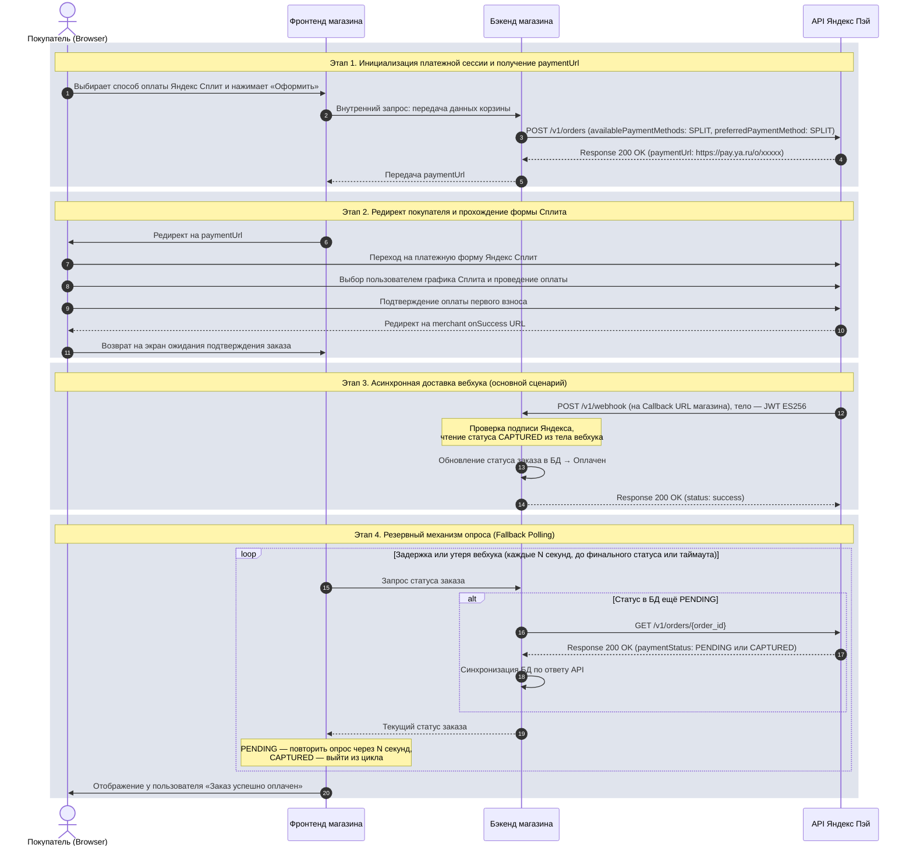

# Сценарий оплаты через Яндекс Сплит

Схема взаимодействия покупателя, фронтенда и бэкенда магазина и API Яндекс Пэй при оплате через Сплит. Показаны четыре этапа:

1. Создание платёжной сессии и получение `paymentUrl`.
2. Редирект покупателя на платёжную форму и оплата.
3. Асинхронный вебхук `ORDER_STATUS_UPDATED` со статусом `CAPTURED` — основной способ узнать об оплате.
4. Резервный опрос статуса (fallback polling) — на случай, если вебхук задержался.

## Пояснения

**Почему нужен резервный опрос.** Вебхук асинхронный: он может прийти позже, чем покупатель вернётся на сайт, или не дойти из-за сбоя сети. Яндекс Пэй повторяет отправку до 24 часов, но покупатель не должен ждать. Поэтому страница ожидания опрашивает бэкенд, а бэкенд при необходимости сам запрашивает статус у Яндекс Пэй.

**Ограничьте опрос.** Задайте интервал (например, 2–3 секунды) и общий таймаут. Если статус так и не стал финальным, покажите покупателю, что оплата обрабатывается, и не создавайте заказ повторно.

**Источник истины — бэкенд.** Фронтенд не обращается к API Яндекс Пэй напрямую и не считает заказ оплаченным по факту редиректа на `onSuccess`. Статус «Оплачен» ставит только бэкенд — по проверенному вебхуку или по ответу `GET /v1/orders/{order_id}`.

**Обработка повторов.** Если вебхук пришёл после того, как статус уже обновлён опросом, бэкенд просто отвечает `200 OK` — повторная обработка не нужна.
