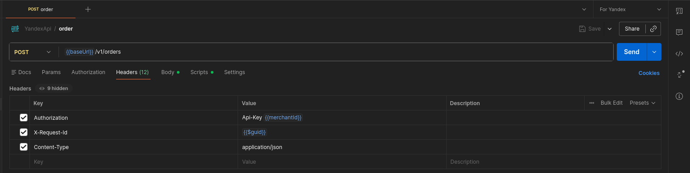
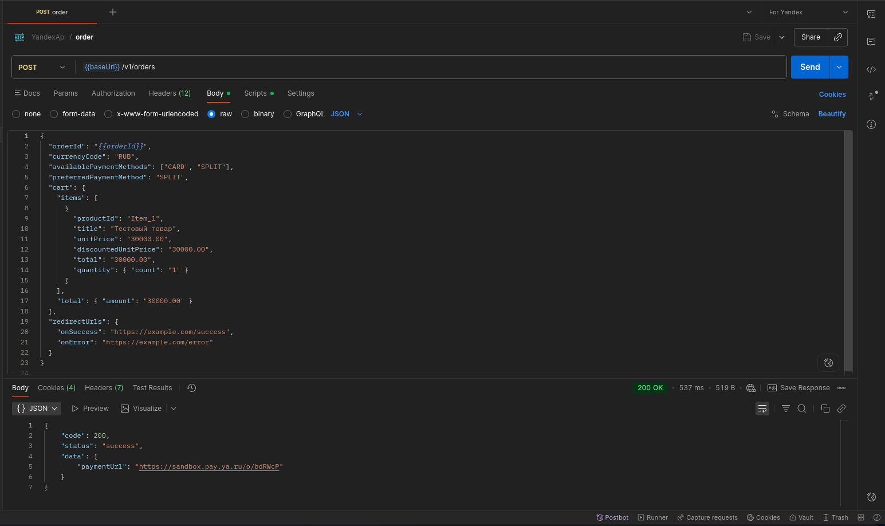
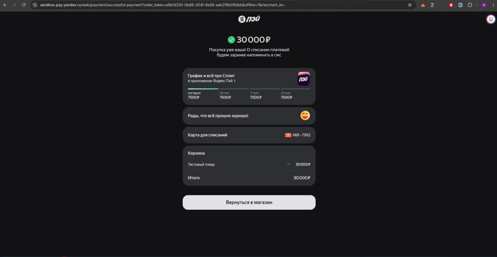
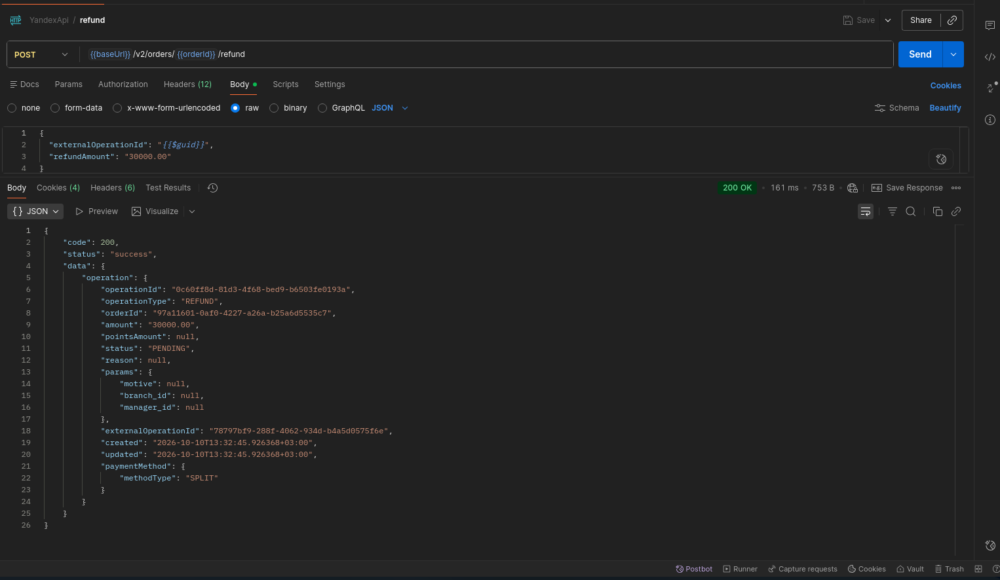
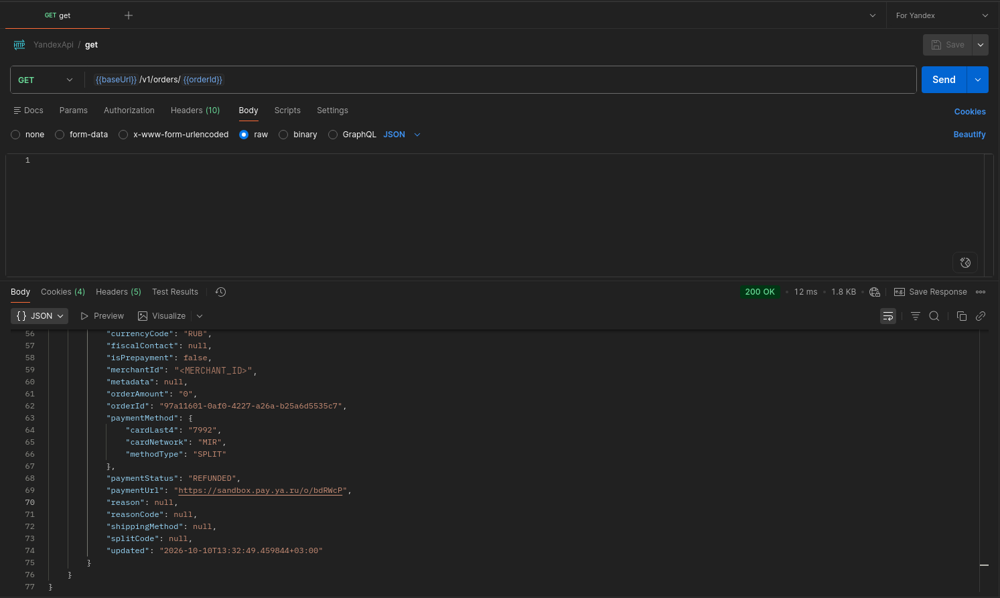

# Руководство по тестированию в Sandbox

Настоящее руководство составлено для команды разработки внешнего партнёра и описывает методику сквозного (E2E) тестирования оплаты частями через сервис Яндекс Сплит в тестовом контуре (Sandbox).

!!! info "Важное примечание по авторизации"
    В Sandbox в качестве API-ключа в заголовке `Authorization: Api-Key <значение>` передаётся идентификатор продавца `merchantId`. В Production в данном заголовке передаётся отдельно выпущенный секретный Merchant API Key.

## Этап 1. Настройка окружения и служебных заголовков в Postman

Для удобства тестирования рекомендуется создать окружение (Environment) в Postman со следующими динамическими переменными:

- **baseUrl:** `https://sandbox.pay.yandex.ru/api/merchant`
- **merchantId:** `<MERCHANT_ID>` — идентификатор вашего тестового магазина (в Sandbox используется в качестве API-ключа).
- **orderId:** любое уникальное имя. Уникальность ID критична для предотвращения коллизий при повторных прогонах. Можно задать через Pre-request script запроса на создание заказа:

    ```javascript
    pm.collectionVariables.set("orderId", pm.variables.replaceIn("{{$guid}}"));
    ```

**Обязательные Headers:**

- `Authorization: Api-Key {{merchantId}}`
- `Content-Type: application/json`
- `X-Request-Id: {{$guid}}` — уникальный идентификатор запроса. Используется для сквозного логирования, отладки и обеспечения идемпотентности сетевых повторов.



## Этап 2. Создание заказа для Яндекс Сплит (POST /v1/orders)

Запрос инициирует платёжную сессию. Для активации Сплита в теле запроса передаются параметры `availablePaymentMethods` со значением `["CARD", "SPLIT"]` или только `["SPLIT"]` и `preferredPaymentMethod` = `"SPLIT"`. Состав корзины и названия позиций выбираются под задачи теста.

```json
{
  "orderId": "{{orderId}}",
  "currencyCode": "RUB",
  "availablePaymentMethods": ["CARD", "SPLIT"],
  "preferredPaymentMethod": "SPLIT",
  "cart": {
    "items": [
      {
        "productId": "Item_1",
        "title": "Тестовый товар",
        "unitPrice": "30000.00",
        "discountedUnitPrice": "30000.00",
        "total": "30000.00",
        "quantity": { "count": "1" }
      }
    ],
    "total": { "amount": "30000.00" }
  },
  "redirectUrls": {
    "onSuccess": "https://example.com/success",
    "onError": "https://example.com/error"
  }
}
```



## Этап 3. Прохождение чекаута и оплата на форме Яндекс Сплит

Из ответа сервера (`data.paymentUrl`) скопируйте полученную ссылку и откройте её в браузере. Проведите транзакцию с помощью эмуляции Sandbox. Статус заказа перейдёт в `CAPTURED`.



## Этап 4. Проверка входящего асинхронного вебхука {#webhook}

После списания первого платежа Яндекс отправляет POST-уведомление `ORDER_STATUS_UPDATED` с `paymentStatus` = `"CAPTURED"` на зарегистрированный Callback URL. Тело уведомления JWT-токен, подписанный алгоритмом ES256. Бэкенд должен верифицировать подпись токена с помощью публичных ключей Яндекса (JWK) и вернуть HTTP 200 OK.

Пример payload уведомления после проверки подписи:

```json
{
  "merchantId": "<MERCHANT_ID>",
  "event": "ORDER_STATUS_UPDATED",
  "eventTime": "<EVENT_TIME>",
  "order": {
    "orderId": "<ORDER_ID>",
    "paymentStatus": "CAPTURED"
  }
}
```

!!! tip "Если вебхук не приходит"
    Вебхук доставляется только на Callback URL, указанный в настройках магазина в Личном кабинете Яндекс Пэй, и только если этот адрес доступен из интернета. Если Callback URL не указан или вы тестируете на локальной машине (`localhost`), уведомление не придёт, но проверить результат оплаты всё равно можно: запросите статус заказа через `GET /v1/orders/{order_id}` — см. [этап 6](#status-check).

## Этап 5. Возврат средств и аннулирование Сплита (POST /v2/orders/{order_id}/refund)

Для отмены покупки и расторжения договора Сплита бэкенд отправляет запрос на полный возврат средств. В JSON-теле необходимо передать `externalOperationId` — уникальный идентификатор транзакции на стороне магазина (например, `{{$guid}}`), выполняющий функцию токена идемпотентности для защиты от дублирования вызовов.

```json
{
  "externalOperationId": "{{$guid}}",
  "refundAmount": "30000.00"
}
```



Нотификация об операции (`OPERATION_STATUS_UPDATED`):

```json
{
  "merchantId": "<MERCHANT_ID>",
  "event": "OPERATION_STATUS_UPDATED",
  "eventTime": "2026-10-10T13:32:49.459844+03:00",
  "operation": {
    "operationId": "0c60ff8d-81d3-4f68-bed9-b6503fe0193a",
    "externalOperationId": "78797bf9-288f-4062-934d-b4a5d0575f6e",
    "orderId": "97a11601-0af0-4227-a26a-b25a6d5535c7",
    "status": "SUCCESS",
    "operationType": "REFUND"
  }
}
```

Нотификация о статусе заказа (`ORDER_STATUS_UPDATED`):

```json
{
  "merchantId": "<MERCHANT_ID>",
  "event": "ORDER_STATUS_UPDATED",
  "eventTime": "2026-10-10T13:32:49.459844+03:00",
  "order": {
    "orderId": "97a11601-0af0-4227-a26a-b25a6d5535c7",
    "paymentStatus": "REFUNDED"
  }
}
```

## Этап 6. Проверка статуса заказа (GET /v1/orders/{order_id}) {#status-check}

Итоговый статус заказа и операций можно проверить запросом `GET {{baseUrl}}/v1/orders/{{orderId}}`. После полного возврата в ответе: `paymentStatus` заказа — `REFUNDED`, операции `AUTHORIZE` и `REFUND` — в статусе `SUCCESS`.



Полные логи запросов и ответов этого прогона — в [`examples/logs`](https://github.com/flavrinets-hash/yandex-pay-split-docs/tree/main/examples/logs).
