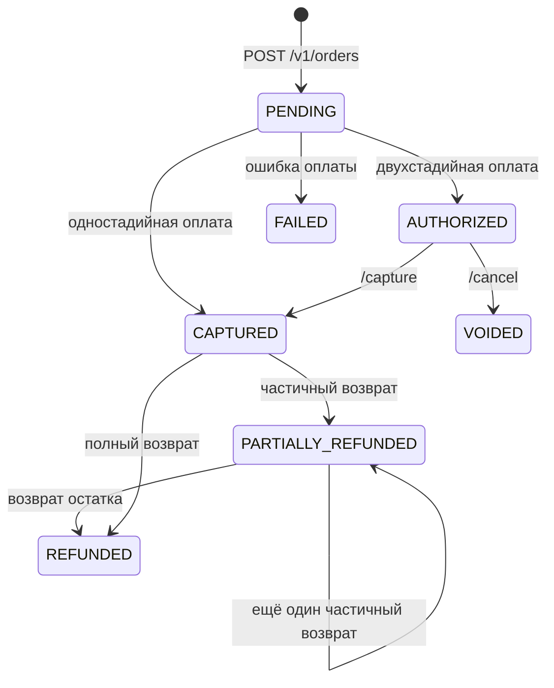

# Статусы заказа и операций

У заказа и у каждой операции над ним свои статусы. Статус заказа показывает итог по платежу, статус операции — результат конкретного действия: списания, возврата, отмены.

Источник: [Статусы платежей и операций](https://pay.yandex.ru/docs/ru/payments/statuses) в документации Яндекс Пэй.

## Статус заказа — `paymentStatus`

| Статус | Значение |
| --- | --- |
| `PENDING` | Заказ создан и ожидает оплаты |
| `AUTHORIZED` | Средства захолдированы (двухстадийная оплата). Чтобы списать их, магазин подтверждает покупку методом `/capture` |
| `CAPTURED` | Платёж проведён, средства списаны |
| `CONFIRMED` | Покупатель подтвердил оформление заказа |
| `PARTIALLY_REFUNDED` | Покупателю возвращена часть средств |
| `REFUNDED` | Покупателю возвращена вся сумма |
| `VOIDED` | Платёж отменён до списания средств |
| `FAILED` | Платёж не прошёл или отменён |

### Типичные переходы

## Статус операции — `status`

| Статус | Значение |
| --- | --- |
| `PENDING` | Операция обрабатывается |
| `SUCCESS` | Операция успешно завершена |
| `FAIL` | Операция завершилась ошибкой |

## Тип операции — `operationType`

| Тип | Что происходит |
| --- | --- |
| `AUTHORIZE` | Оплата заказа покупателем: списание (одностадийная оплата) или холдирование (двухстадийная) |
| `CAPTURE` | Списание захолдированных средств |
| `REFUND` | Возврат средств |
| `VOID` | Отмена платежа до списания |

В API есть и другие типы операций (`BIND_CARD`, `RECURRING`, `PREPAYMENT`, `SUBMIT`) — они относятся к сценариям, которые не описаны в этой документации.

## Пример: полный возврат по логам Sandbox

Запрос `GET /v1/orders/{order_id}` после полного возврата ([полный лог](https://github.com/flavrinets-hash/yandex-pay-split-docs/blob/main/examples/logs/03-get-order.json)):

| Объект | Тип | Статус |
| --- | --- | --- |
| Заказ | — | `REFUNDED` |
| Операция | `AUTHORIZE` | `SUCCESS` |
| Операция | `REFUND` | `SUCCESS` |
