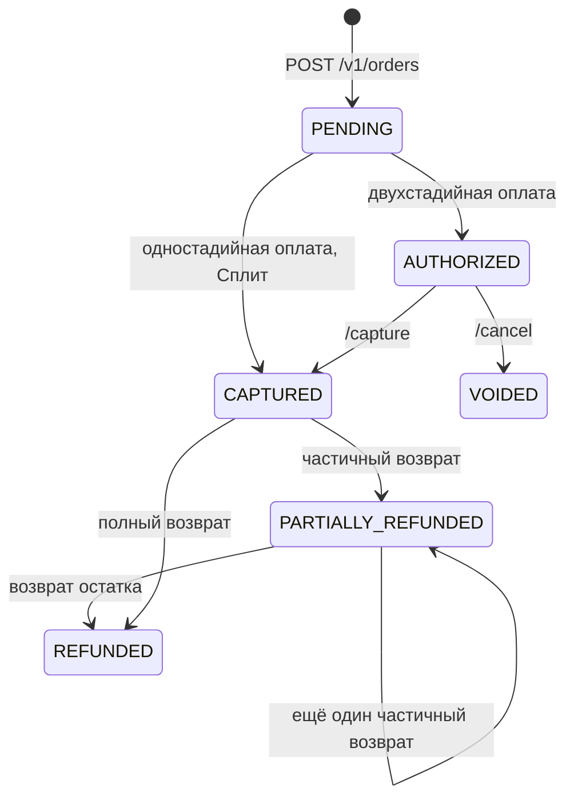

# Статусы заказа и операций

У заказа и у каждой операции над ним свои статусы:

- **статус заказа** (`paymentStatus`) показывает итог по платежу в целом;
- **статус операции** (`status`) показывает результат конкретного действия: оплаты, списания, возврата, отмены.

Магазину нужны оба: решение «выдать заказ» принимается по статусу заказа, а результат возврата или отмены виден только в статусе операции.

Источник: [Статусы платежей и операций](https://pay.yandex.ru/docs/ru/payments/statuses) в документации Яндекс Пэй. Столбец «Что делать магазину» — рекомендации этой документации, а не требования API.

## Статус заказа — `paymentStatus`

| Статус | Значение | Что делать магазину |
| --- | --- | --- |
| `PENDING` | Заказ создан и ожидает оплаты | Ждать вебхук или опрашивать статус. Заказ не выдавать |
| `AUTHORIZED` | Средства захолдированы, но не списаны (только двухстадийная оплата) | Подтвердить покупку методом `/capture` или отменить методом `/cancel` |
| `CAPTURED` | Платёж проведён, средства списаны | Считать заказ оплаченным и выдавать товар. Возможны возвраты |
| `PARTIALLY_REFUNDED` | Покупателю возвращена часть средств | Обновить заказ в своей системе. Возможны ещё частичные возвраты или возврат остатка |
| `REFUNDED` | Покупателю возвращена вся сумма | Закрыть заказ. Дальнейших операций по нему нет |
| `VOIDED` | Платёж отменён методом `/cancel` (двухстадийная оплата) или `/rollback` | Закрыть заказ как отменённый |
| `FAILED` | Платёж отменён методом `/rollback` | Закрыть заказ как неоплаченный |

`CONFIRMED` («покупатель подтвердил оформление заказа») встречается только в сценарии Сплит с оплатой при получении, который в этой документации не описан.

!!! warning "Во время возврата заказ остаётся в прежнем статусе"
    Пока полный возврат обрабатывается, заказ остаётся в `CAPTURED`. Пока обрабатывается частичный возврат — в `CAPTURED`, если это первый возврат, или в `PARTIALLY_REFUNDED`, если частичный возврат уже был.

    Если возврат завершился ошибкой, заказ находится в `CAPTURED`. В этом случае Яндекс Пэй рекомендует обратиться в поддержку.

    Результат возврата смотрите в статусе операции `REFUND`, а не заказа.

### Переходы между статусами

Переход `PENDING → CAPTURED` для Сплита на странице статусов Яндекс Пэй отдельно не описан. Он подтверждён запросами в Sandbox — см. [пример ниже](#split-example).

## Статус операции — `status`

| Статус | Значение |
| --- | --- |
| `PENDING` | Операция обрабатывается |
| `SUCCESS` | Операция успешно завершена |
| `FAIL` | Операция завершилась ошибкой |

!!! note "`PENDING` у заказа и у операции — разные вещи"
    `paymentStatus: PENDING` значит, что покупатель ещё не оплатил заказ. `status: PENDING` у операции значит, что Яндекс Пэй обрабатывает конкретное действие, например возврат. Заказ при этом может быть давно оплачен (`CAPTURED`).

## Тип операции — `operationType`

| Тип | Что происходит |
| --- | --- |
| `AUTHORIZE` | Оплата заказа покупателем: списание (одностадийная оплата) или холдирование (двухстадийная) |
| `CAPTURE` | Проведение платежа, списание средств |
| `REFUND` | Возврат средств |
| `VOID` | Отмена платежа до списания (`/cancel` или `/rollback`) |

В API есть и другие типы операций (`BIND_CARD`, `RECURRING`, `PREPAYMENT`, `SUBMIT`). Они относятся к сценариям, которые в этой документации не описаны.

## Как возврат и отмена меняют статус заказа

| Операция | Статус операции | Статус заказа |
| --- | --- | --- |
| `REFUND` (полный возврат) | `PENDING` | Остаётся `CAPTURED` |
| `REFUND` (частичный возврат) | `PENDING` | Остаётся `CAPTURED` или `PARTIALLY_REFUNDED` |
| `REFUND` | `SUCCESS` | `PARTIALLY_REFUNDED` или `REFUNDED` |
| `REFUND` | Ошибка возврата | `CAPTURED` |
| `VOID` через `/cancel` | `SUCCESS` | `VOIDED` |
| `VOID` через `/rollback` | `SUCCESS` | `FAILED` или `VOIDED` |

Для операций оплаты (`AUTHORIZE`, `CAPTURE`) документация Яндекс Пэй не приводит однозначного соответствия статусам заказа. Как это выглядит на практике для Сплита — в примере ниже.

## Пример: оплата Сплитом по логам Sandbox {#split-example}

Ответы `GET /v1/orders/{order_id}` из двух прогонов в Sandbox:

| Момент запроса | Статус заказа | Операции | Лог |
| --- | --- | --- | --- |
| После оплаты Сплитом | `CAPTURED` | `AUTHORIZE` на 30 000.00 — `SUCCESS` | [04-get-order-captured.json](https://github.com/flavrinets-hash/yandex-pay-split-docs/blob/main/examples/logs/04-get-order-captured.json) |
| После полного возврата | `REFUNDED` | `AUTHORIZE` на 30 000.00 — `SUCCESS`, `REFUND` на 30 000.00 — `SUCCESS` | [03-get-order.json](https://github.com/flavrinets-hash/yandex-pay-split-docs/blob/main/examples/logs/03-get-order.json) |

В обоих случаях у заказа `paymentMethod.methodType: SPLIT`. Для магазина оплата Сплитом выглядит как одностадийная: одна операция `AUTHORIZE` на всю сумму заказа, без отдельного `CAPTURE`, и заказ сразу переходит в `CAPTURED`, хотя покупатель платит частями.
